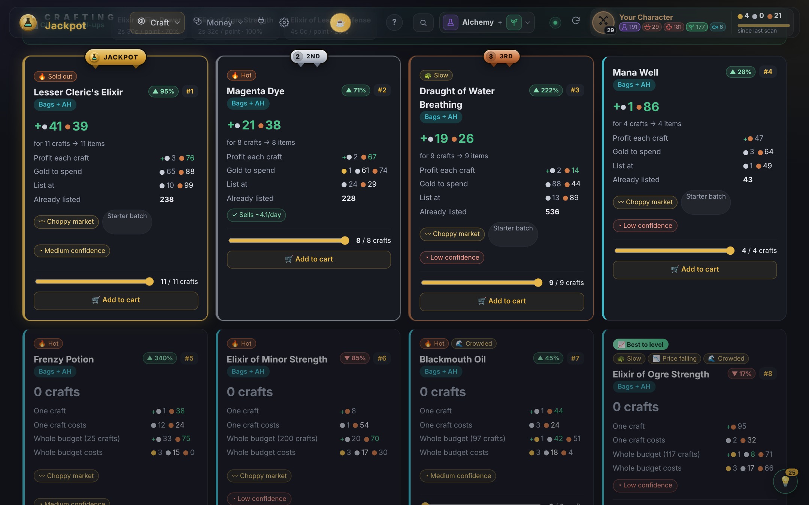
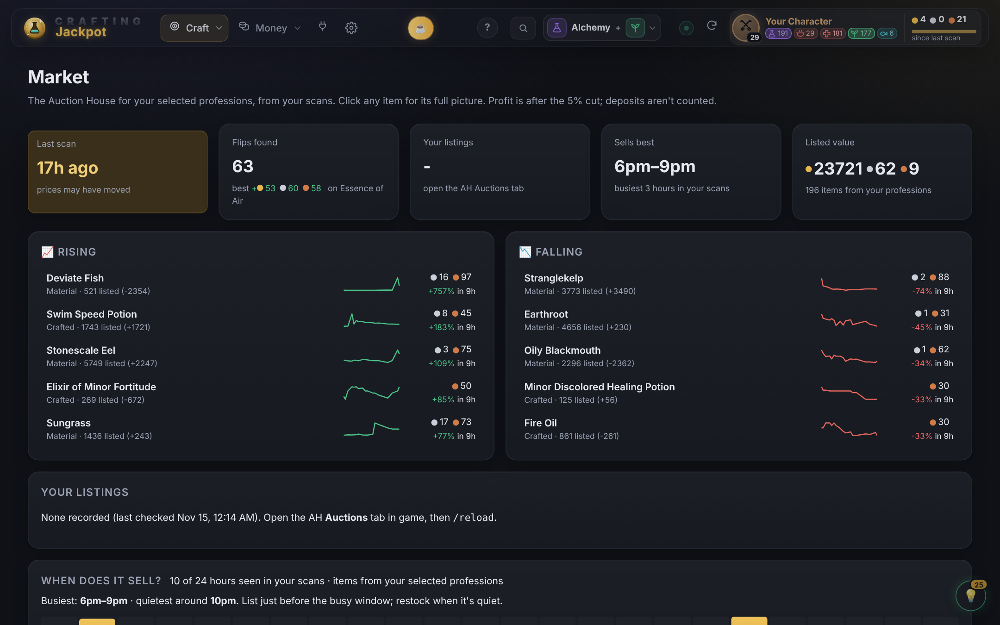
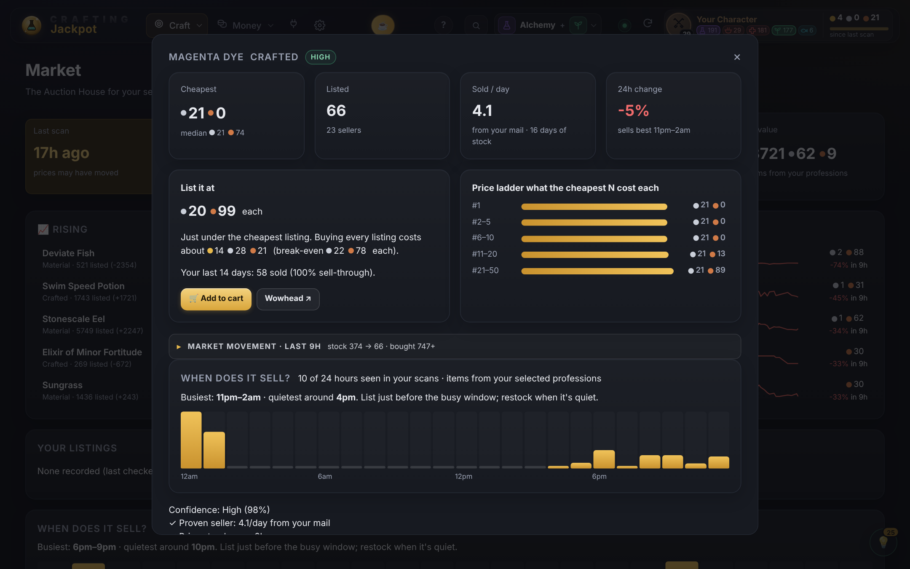
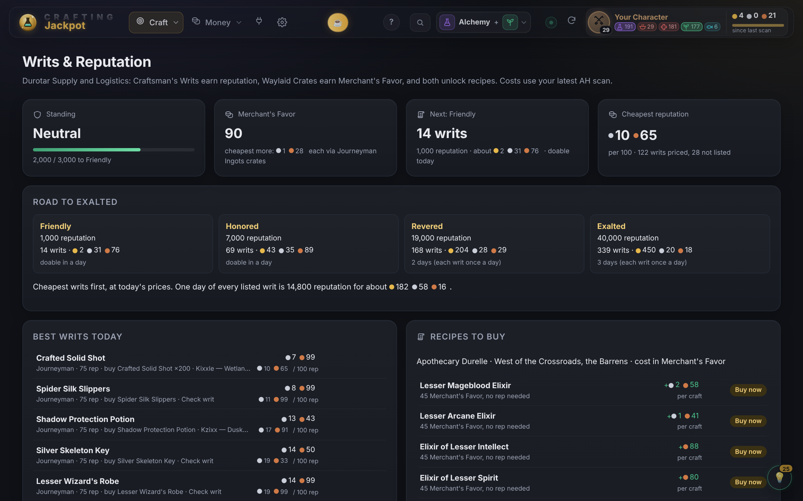
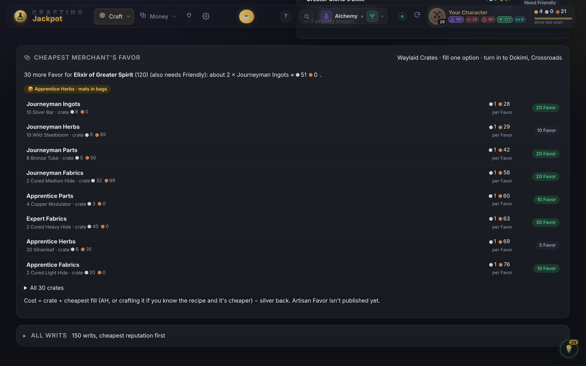

# Crafting Jackpot

**A crafting and gold planner for WoW Forever.** A free Windows app plus a small in-game addon. It reads your own Auction House scans and tells you what's worth crafting, how many to make, and what to buy.

## Download

Get **Crafting Jackpot.exe** from the [latest release](../../releases/latest). That one file is all you need: the addon and a blank data file are built in.

> Windows may say "Windows protected your PC" because the app isn't code-signed. Click **More info → Run anyway**. Some antivirus programs also flag unsigned apps; that's common for small free tools.

## What it does

- **Jackpot:** ranks everything you can craft by real profit for your budget (after the 5% AH cut), capped by how much the market can absorb, and weighed by how much the data can be trusted. Gold flag for the best pick, medals for 2nd and 3rd, and a purple **Risky Jackpot** for a bigger payout with shakier data.
- **Every profession:** all 8 crafting professions (2,300+ recipes built in) and 6 gathering ones. Pick one, several or all.
- **Your prices, not someone else's:** everything comes from your own AH scan, including the price ladder (what 20 really costs). No prices are bundled.
- **Smart batch sizes:** based on what actually sells (your own AH mail sales when you have them), minus what you already have listed or in your bags.
- **Market page:** flips, rising and falling prices with trend lines, your own listings with undercut checks and relist prices, best hours to sell. Click any item for its price history, price ladder and a suggested list price.
- **Search everything** (Ctrl+K): every recipe and material, plus anything on the Auction House from your last scan.
- **Writs & Reputation:** your Durotar Supply standing, Merchant's Favor, the cheapest writs today and the road to Exalted. **Cheapest Merchant's Favor** ranks every Waylaid Crate by gold per Favor.
- **Carts:** add crafts to a cart; it tracks what you've bought from bags, bank and mail, shows your gold goal, and sends the list to the in-game window.
- **In game:** shopping list, Picks and History window, bag worth, and profit, disenchant and skinning values in tooltips.

| Market | Item detail |
|---|---|
|  |  |

| Writs & Reputation | Cheapest Merchant's Favor |
|---|---|
|  |  |

## Install (about 2 minutes)

1. Put **Crafting Jackpot.exe** anywhere you like and double-click it.
2. In the app, open **Data sources** (plug icon) and click **Install addon**. If WoW isn't in a usual place, it asks you to pick your `_forever_` folder once.
3. **Fully restart WoW** and make sure "Crafting Jackpot" is ticked in the AddOns list.
4. In game, open each profession window once and your bank once.
5. At the Auction House, click **Scan prices** (top right). Open your mailbox and the AH Auctions tab too.
6. Type `/reload`, then click **Refresh** in the app.

Tip: scan at different times of day. The app learns when things sell best.

## Safe by design

- The addon only reads what's already on your screen. Its one request to Blizzard is the Scan prices button, only when you click it.
- It never buys, bids, posts, cancels, crafts or clicks anything for you. No automation of any kind.
- Everything stays on your PC. The app only goes online to check for a new version, or when you click a link.

## Commands

`/cj` status · `/cj cart` shopping list · `/cj picks` · `/cj history` · `/cj button` · `/cj alert` · `/cj tips` · `/cj bags` (`/acomp` works too). Type `/reload` after scanning so WoW saves the data.

## Updates

The app tells you when a new version is out. Click **Download**, then replace your old Crafting Jackpot.exe with the new one. If it says the addon has an update, click **Update addon** and `/reload`.

## Feedback

Found a bug or have an idea? [Open an issue](../../issues/new). Screenshots help a lot (type `/cj` in game and include the result if something looks wrong).

## Support

Crafting Jackpot is free. If it's made you some gold and you'd like to say thanks: [paypal.me/BCelis](https://paypal.me/BCelis)

## Credits

Recipe reagents and grey levels from the game client (via wowforever.one); learn skills cross-checked with Booty Bay Broker; recipe locations from Warcraft Wiki, Metaforge and Zockify. Prices always come from your own scans.

## License

© 2026 Bam. All rights reserved. Free for personal use; please don't repost, resell or redistribute without permission.

*Fan-made tool. Not affiliated with or endorsed by Blizzard Entertainment. World of Warcraft is a trademark of Blizzard Entertainment, Inc.*
